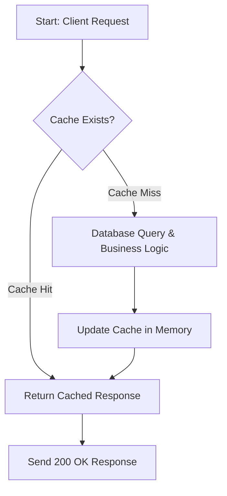
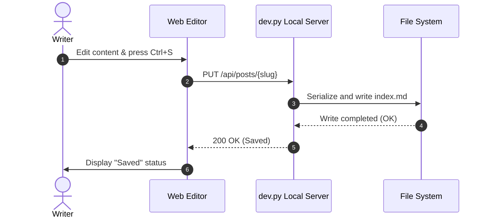

This page is a comprehensive validation test suite covering all rendering capabilities of the `hugodex-k` blog engine: KaTeX math equations, Mermaid diagrams, responsive images, code syntax highlighting, callouts, tables, and tabs.

---

## 1. Images and Automatic Thumbnails

The `image.jpg` file located in this post's bundle folder is automatically converted into a **256x256 high-efficiency thumbnail** on post lists, while rendering in full resolution inside the article body below:


---

## 2. LaTeX Mathematics (KaTeX)

### 2.1 Inline Math
Formulas embedded naturally within the prose:
- Euler's Identity: $e^{i\pi} + 1 = 0$
- Limits: $\lim_{x \to 0} \frac{\sin x}{x} = 1$
- Symbols: $\forall x \in \mathbb{R}$, $\exists \epsilon > 0$, $\alpha, \beta, \gamma, \delta, \lambda, \mu, \sigma, \omega, \Omega, \Delta$

### 2.2 Display Block Math with Mobile Responsiveness
Wide equations do not overflow the viewport on small mobile screens; they scroll horizontally with ease:

Gaussian Integral:
$$
\int_{-\infty}^{\infty} e^{-x^2} \, dx = \sqrt{\pi}
$$

Maxwell's Equations:
$$
\begin{aligned}
\nabla \cdot \mathbf{E} &= \frac{\rho}{\varepsilon_0} \\
\nabla \cdot \mathbf{B} &= 0 \\
\nabla \times \mathbf{E} &= -\frac{\partial \mathbf{B}}{\partial t} \\
\nabla \times \mathbf{B} &= \mu_0 \left( \mathbf{J} + \varepsilon_0 \frac{\partial \mathbf{E}}{\partial t} \right)
\end{aligned}
$$

Matrices and System of Cases:
$$
\mathbf{A} = \begin{pmatrix} a_{11} & a_{12} & a_{13} \\ a_{21} & a_{22} & a_{23} \\ a_{31} & a_{32} & a_{33} \end{pmatrix}, \quad
f(x) = \begin{cases} 
x^2 \sin\left(\frac{1}{x}\right), & x \neq 0 \\ 
0, & x = 0 
\end{cases}
$$

---

## 3. Diagrams (Mermaid)

### 3.1 Flowchart



### 3.2 Sequence Diagram



---

## 4. Directly Editable Inline SVG Vector Diagrams

Beyond generated charts like Mermaid, you can directly embed raw `<svg>` code into Markdown for pixel-precise custom vector diagrams. With a responsive `viewBox`, diagrams scale cleanly on mobile devices without distortion:

<svg viewBox="0 0 540 120" width="100%" xmlns="http://www.w3.org/2000/svg" style="max-width: 100%; height: auto; margin: 1.5rem auto; display: block;">
  <rect x="10" y="25" width="140" height="70" rx="8" fill="var(--bg-secondary, #f8fafc)" stroke="var(--border-color, #cbd5e1)" stroke-width="2"/>
  <text x="80" y="65" text-anchor="middle" font-size="13" font-weight="600" fill="var(--text-primary, #0f172a)">Client</text>
  
  <line x1="150" y1="60" x2="215" y2="60" stroke="var(--accent, #059669)" stroke-width="2" stroke-dasharray="4"/>
  <polygon points="215,55 225,60 215,65" fill="var(--accent, #059669)"/>
  
  <rect x="225" y="25" width="150" height="70" rx="8" fill="var(--bg-secondary, #f8fafc)" stroke="var(--accent, #059669)" stroke-width="2"/>
  <text x="300" y="65" text-anchor="middle" font-size="13" font-weight="600" fill="var(--accent, #059669)">API Gateway</text>
  
  <line x1="375" y1="60" x2="440" y2="60" stroke="var(--accent, #059669)" stroke-width="2"/>
  <polygon points="440,55 450,60 440,65" fill="var(--accent, #059669)"/>
  
  <rect x="450" y="25" width="80" height="70" rx="8" fill="var(--bg-secondary, #f8fafc)" stroke="var(--border-color, #cbd5e1)" stroke-width="2"/>
  <text x="490" y="65" text-anchor="middle" font-size="13" font-weight="600" fill="var(--text-primary, #0f172a)">Database</text>
</svg>

---

## 5. Live Interactive Inline HTML Components

With Hugo Goldmark's `unsafe: true` configuration and custom responsive widget styles, you can directly embed HTML5 `<canvas>`, `<input type="range">`, `<button>`, and `<script>` blocks. Interactive widgets function in real time both in the web editor preview and on the deployed site:

<div class="interactive-widget">
  <div style="font-weight: 700; margin-bottom: 0.5rem; font-size: 0.95rem;">⚡ Real-time Sine Wave Amplitude Simulator</div>
  <div style="display: flex; gap: 0.75rem; align-items: center; margin-bottom: 0.75rem; flex-wrap: wrap;">
    <label for="sineAmpRangeEn" style="font-size: 0.85rem; font-weight: 500;">Amplitude:</label>
    <input type="range" id="sineAmpRangeEn" min="10" max="90" value="45" style="cursor: pointer;">
    <span id="sineAmpDisplayEn" style="font-family: monospace; font-weight: bold; color: var(--accent, #059669);">45</span>
  </div>
  <canvas id="sineWaveCanvasEn" width="540" height="90" style="width: 100%; max-width: 540px; height: 90px; background: #0f172a; border-radius: 6px; display: block;"></canvas>
  <script>
    (function() {
      const canvas = document.getElementById('sineWaveCanvasEn');
      if (!canvas) return;
      const ctx = canvas.getContext('2d');
      const slider = document.getElementById('sineAmpRangeEn');
      const display = document.getElementById('sineAmpDisplayEn');
      function draw() {
        ctx.clearRect(0, 0, canvas.width, canvas.height);
        ctx.strokeStyle = '#10b981';
        ctx.lineWidth = 2.5;
        ctx.beginPath();
        const amp = slider ? Number(slider.value) : 45;
        for (let x = 0; x < canvas.width; x++) {
          const y = 45 + Math.sin(x * 0.04) * (amp * 0.4);
          if (x === 0) ctx.moveTo(x, y);
          else ctx.lineTo(x, y);
        }
        ctx.stroke();
      }
      if (slider) {
        slider.oninput = function() {
          if (display) display.innerText = this.value;
          draw();
        };
      }
      draw();
    })();
  </script>
</div>

---

## 6. Code Blocks with Syntax Highlighting

Quickly copy source code to clipboard using the button in the header.

```python
def quicksort(arr: list[int]) -> list[int]:
    """Clean and standard QuickSort implementation."""
    if len(arr) <= 1:
        return arr
    pivot = arr[len(arr) // 2]
    left = [x for x in arr if x < pivot]
    middle = [x for x in arr if x == pivot]
    right = [x for x in arr if x > pivot]
    return quicksort(left) + middle + quicksort(right)

print(quicksort([3, 6, 8, 10, 1, 2, 1]))
```

---

## 5. Callouts


In any right-angled triangle, the area of the square whose side is the hypotenuse is equal to the sum of the areas of the squares on the other two sides:
$$
a^2 + b^2 = c^2
$$



When an image is added to a post bundle, Hugo automatically detects the first image and converts it into a `256x256` thumbnail.


---

## 6. Table

| Component | Technology | Role |
| :--- | :--- | :--- |
| SSG Engine | Hugo Extended 0.139 | Fast static generation & image pipeline |
| Math Engine | KaTeX | Bundled client-side LaTeX math rendering |
| Diagrams | Mermaid.js | Plain-text charts and diagrams |
| Local Server | Python 3 (dev.py) | Zero-dependency local REST API server |

---

## 7. Tabs Component



```python
def greet(name: str) -> str:
    return f"Hello, {name}!"
```


```go
package main

import "fmt"

func Greet(name string) string {
    return fmt.Sprintf("Hello, %s!", name)
}
```


