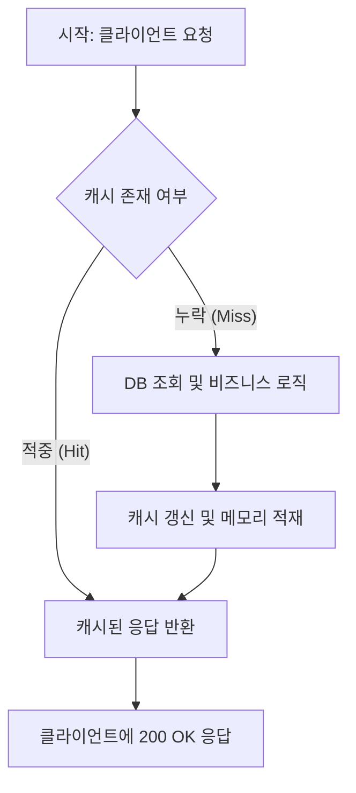
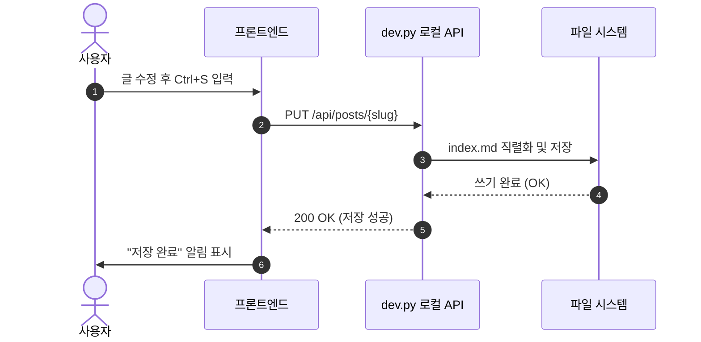

`hugodex-k` 블로그 엔진의 모든 렌더링 파이프라인(KaTeX 수학 수식, Mermaid 다이어그램, 직접 편집 가능한 인라인 SVG, 실시간 인터랙티브 HTML 컴포넌트, 반응형 이미지, 코드 블록, 콜아웃, 표, 탭)을 포괄하는 종합 검증 페이지입니다.

---

## 1. 이미지 및 썸네일 검증

포스트 폴더에 동봉된 `image.jpg`는 글 목록에서 **256x256 고효율 썸네일**로 변환되어 빠른 로딩을 지원하며, 본문에서는 아래와 같이 고화질 원본 이미지로 렌더링됩니다.


---

## 2. LaTeX 수식 (KaTeX)

### 2.1 인라인 수식
본문 흐름 속에 자연스럽게 렌더링되는 인라인 수식입니다:
- 오일러 공식: $e^{i\pi} + 1 = 0$
- 극한: $\lim_{x \to 0} \frac{\sin x}{x} = 1$
- 주요 기호: $\forall x \in \mathbb{R}$, $\exists \epsilon > 0$, $\alpha, \beta, \gamma, \delta, \lambda, \mu, \sigma, \omega, \Omega, \Delta$

### 2.2 디스플레이 블록 수식 및 모바일 반응형
모바일 화면에서도 수식이 바깥으로 넘치지 않고 가로 터치 스크롤됩니다.

가우스 적분(Gaussian Integral):
$$
\int_{-\infty}^{\infty} e^{-x^2} \, dx = \sqrt{\pi}
$$

맥스웰 방정식(Maxwell's Equations):
$$
\begin{aligned}
\nabla \cdot \mathbf{E} &= \frac{\rho}{\varepsilon_0} \\
\nabla \cdot \mathbf{B} &= 0 \\
\nabla \times \mathbf{E} &= -\frac{\partial \mathbf{B}}{\partial t} \\
\nabla \times \mathbf{B} &= \mu_0 \left( \mathbf{J} + \varepsilon_0 \frac{\partial \mathbf{E}}{\partial t} \right)
\end{aligned}
$$

행렬 및 연립방정식:
$$
\mathbf{A} = \begin{pmatrix} a_{11} & a_{12} & a_{13} \\ a_{21} & a_{22} & a_{23} \\ a_{31} & a_{32} & a_{33} \end{pmatrix}, \quad
f(x) = \begin{cases} 
x^2 \sin\left(\frac{1}{x}\right), & x \neq 0 \\ 
0, & x = 0 
\end{cases}
$$

---

## 3. 다이어그램 (Mermaid)

### 3.1 순서도 (Flowchart)



### 3.2 시퀀스 다이어그램 (Sequence)



---

## 4. 직접 편집 가능한 인라인 SVG 벡터 다이어그램

Mermaid 같은 생성형 다이어그램 외에도 마크다운 본문에 직접 `<svg>` 코드를 삽입하여 커스텀 벡터 일러스트레이션을 정밀하게 제어할 수 있습니다. 반응형 `viewBox` 속성을 통해 모바일 화면에서도 깨짐 없이 완벽하게 자동 스케일링됩니다.

<svg viewBox="0 0 540 120" width="100%" xmlns="http://www.w3.org/2000/svg" style="max-width: 100%; height: auto; margin: 1.5rem auto; display: block;">
  <rect x="10" y="25" width="140" height="70" rx="8" fill="var(--bg-secondary, #f8fafc)" stroke="var(--border-color, #cbd5e1)" stroke-width="2"/>
  <text x="80" y="65" text-anchor="middle" font-size="13" font-weight="600" fill="var(--text-primary, #0f172a)">클라이언트</text>
  
  <line x1="150" y1="60" x2="215" y2="60" stroke="var(--accent, #059669)" stroke-width="2" stroke-dasharray="4"/>
  <polygon points="215,55 225,60 215,65" fill="var(--accent, #059669)"/>
  
  <rect x="225" y="25" width="150" height="70" rx="8" fill="var(--bg-secondary, #f8fafc)" stroke="var(--accent, #059669)" stroke-width="2"/>
  <text x="300" y="65" text-anchor="middle" font-size="13" font-weight="600" fill="var(--accent, #059669)">API 게이트웨이</text>
  
  <line x1="375" y1="60" x2="440" y2="60" stroke="var(--accent, #059669)" stroke-width="2"/>
  <polygon points="440,55 450,60 440,65" fill="var(--accent, #059669)"/>
  
  <rect x="450" y="25" width="80" height="70" rx="8" fill="var(--bg-secondary, #f8fafc)" stroke="var(--border-color, #cbd5e1)" stroke-width="2"/>
  <text x="490" y="65" text-anchor="middle" font-size="13" font-weight="600" fill="var(--text-primary, #0f172a)">데이터베이스</text>
</svg>

---

## 5. 실시간 인터랙티브 인라인 HTML 컴포넌트

Hugo Goldmark의 `unsafe: true` 설정과 블로그의 독립 샌드박스 스타일 덕분에 본문 내에 HTML5 `<canvas>`, `<input type="range">`, `<button>`, `<script>`를 직접 배치할 수 있습니다. 웹 에디터 프리뷰와 최종 배포 블로그 양쪽 모두에서 실시간 조작이 동작합니다:

<div class="interactive-widget">
  <div style="font-weight: 700; margin-bottom: 0.5rem; font-size: 0.95rem;">⚡ 실시간 사인파 진폭 시뮬레이터</div>
  <div style="display: flex; gap: 0.75rem; align-items: center; margin-bottom: 0.75rem; flex-wrap: wrap;">
    <label for="sineAmpRange" style="font-size: 0.85rem; font-weight: 500;">진폭 조절:</label>
    <input type="range" id="sineAmpRange" min="10" max="90" value="45" style="cursor: pointer;">
    <span id="sineAmpDisplay" style="font-family: monospace; font-weight: bold; color: var(--accent, #059669);">45</span>
  </div>
  <canvas id="sineWaveCanvas" width="540" height="90" style="width: 100%; max-width: 540px; height: 90px; background: #0f172a; border-radius: 6px; display: block;"></canvas>
  <script>
    (function() {
      const canvas = document.getElementById('sineWaveCanvas');
      if (!canvas) return;
      const ctx = canvas.getContext('2d');
      const slider = document.getElementById('sineAmpRange');
      const display = document.getElementById('sineAmpDisplay');
      function draw() {
        ctx.clearRect(0, 0, canvas.width, canvas.height);
        ctx.strokeStyle = '#10b981';
        ctx.lineWidth = 2.5;
        ctx.beginPath();
        const amp = slider ? Number(slider.value) : 45;
        for (let x = 0; x < canvas.width; x++) {
          const y = 45 + Math.sin(x * 0.04) * (amp * 0.4);
          if (x === 0) ctx.moveTo(x, y);
          else ctx.lineTo(x, y);
        }
        ctx.stroke();
      }
      if (slider) {
        slider.oninput = function() {
          if (display) display.innerText = this.value;
          draw();
        };
      }
      draw();
    })();
  </script>
</div>

---

## 6. 코드 하이라이팅 (Chroma)

우측 상단 복사 버튼을 통해 클립보드로 소스코드를 손쉽게 복사할 수 있습니다.

```python
def quicksort(arr: list[int]) -> list[int]:
    """간결하고 안전한 퀵 정렬 구현."""
    if len(arr) <= 1:
        return arr
    pivot = arr[len(arr) // 2]
    left = [x for x in arr if x < pivot]
    middle = [x for x in arr if x == pivot]
    right = [x for x in arr if x > pivot]
    return quicksort(left) + middle + quicksort(right)

print(quicksort([3, 6, 8, 10, 1, 2, 1]))
```

---

## 7. 학술 콜아웃 (Callouts)


직각삼각형에서 빗변의 길이의 제곱은 다른 두 변의 길이의 제곱의 합과 같다:
$$
a^2 + b^2 = c^2
$$



포스트 폴더에 이미지를 추가하면 Hugo가 첫 번째 이미지를 찾아 `256x256` 썸네일로 자동 생성합니다.



모바일 기기에서 수식이 잘리지 않도록 긴 수식은 단락 대신 `$$...$$` 블록으로 작성하는 것을 권장합니다.


---

## 8. 표 (Table)

| 구성 요소 | 기술 스택 | 설명 |
| :--- | :--- | :--- |
| 정적 사이트 엔진 | Hugo Extended 0.139 | 고속 정적 빌드 및 이미지 파이프라인 |
| 수학 렌더러 | KaTeX | 로컬 번들 기반 고속 수식 렌더링 |
| 다이어그램 | Mermaid.js / Inline SVG | 텍스트 기반 다이어그램 및 커스텀 벡터 그래픽 |
| 로컬 개발 서버 | Python 3 (dev.py) | 외부 의존성 없는 표준 라이브러리 서버 |

---

## 9. 탭 컴포넌트 (Tabs)



```python
def greet(name: str) -> str:
    return f"Hello, {name}!"
```


```go
package main

import "fmt"

func Greet(name string) string {
    return fmt.Sprintf("Hello, %s!", name)
}
```


```typescript
export function greet(name: string): string {
    return `Hello, ${name}!`;
}
```


