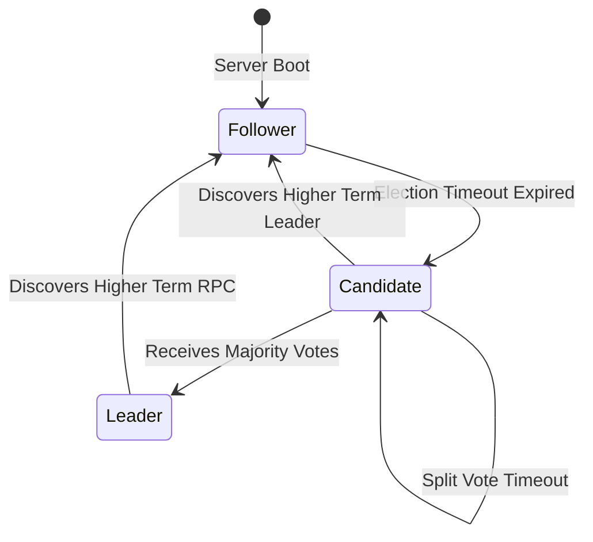
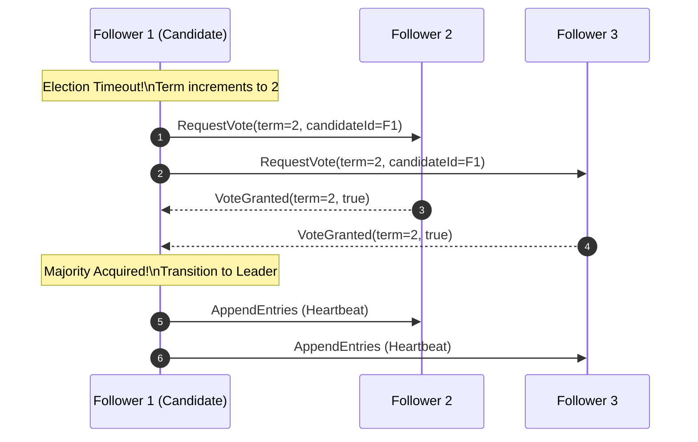

## 1. Overview

In distributed environments where network partitioning and node crashes occur frequently, maintaining a replicated state machine across independent nodes is a classic challenge.

The **Raft Algorithm** addresses this by decomposing consensus into three understandable subproblems:
1. **Leader Election**
2. **Log Replication**
3. **Safety**

---

## 2. Server State Transitions

Every server in a Raft cluster operates in one of three states:

---

## 3. Leader Election Sequence

---

## 4. Summary

Raft provides robust consensus semantics with unparalleled clarity, powering modern systems such as etcd and CockroachDB. With built-in Mermaid and SVG support, architectural flows can be documented directly within Markdown.

