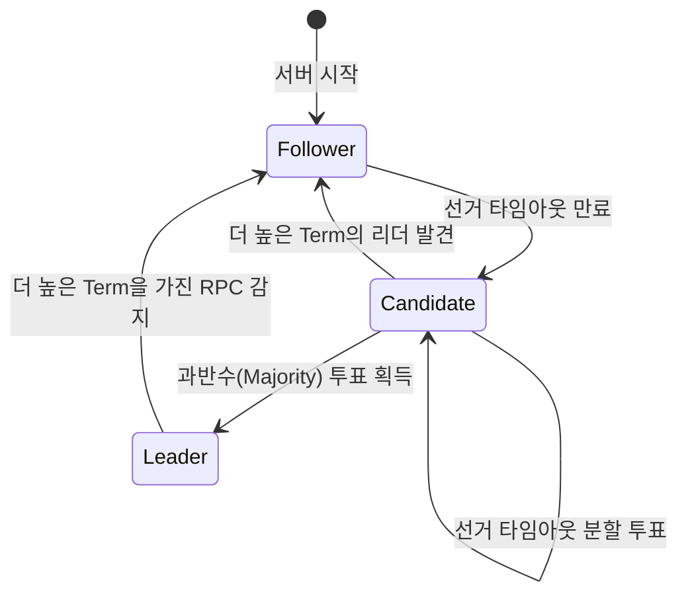
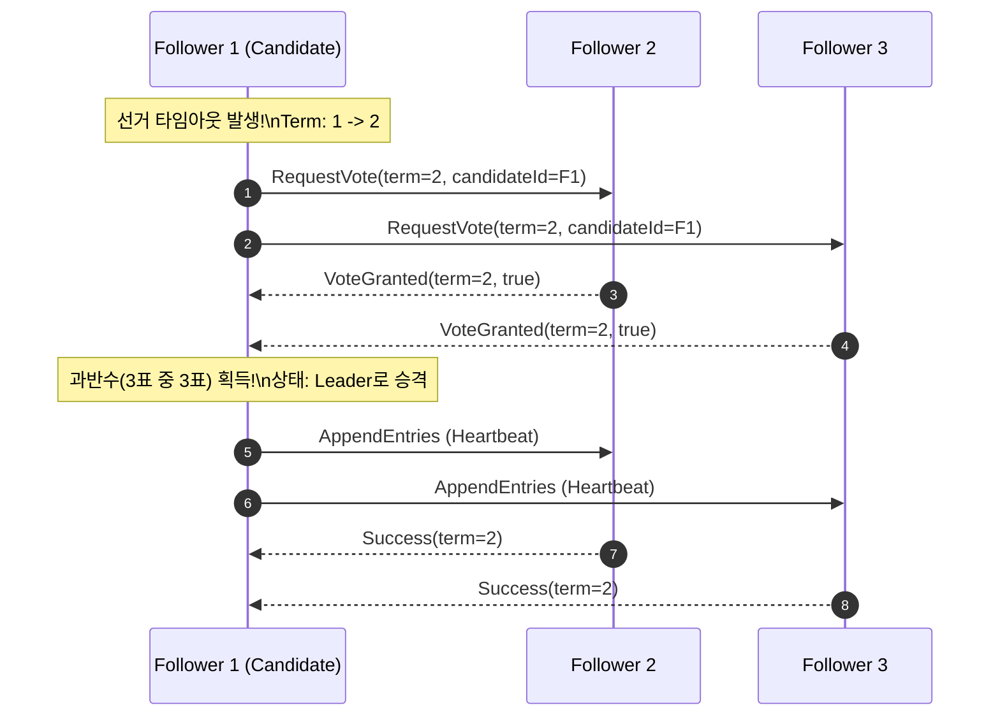

## 1. 분산 합의(Distributed Consensus)의 난제

네트워크 지연, 패킷 유실, 노드 비정상 종료(Crash)가 일상적으로 발생하는 분산 환경에서 여러 서버가 동일한 상태(Replicated State Machine)를 유지하는 것은 매우 어렵습니다.

Paxos의 난해함을 극복하기 위해 설계된 **Raft 알고리즘**은 다음 세 가지 핵심 서브 문제를 독립적으로 해결합니다.

1. **리더 선출 (Leader Election)**
2. **로그 복제 (Log Replication)**
3. **안전성 (Safety)**

---

## 2. 노드 상태 전이도 (State Transition Diagram)

Raft 클러스터의 각 서버는 항상 다음 3가지 상태 중 하나에 위치합니다.

- **Follower (팔로워)**: 수동적 상태. 리더의 심장박동(Heartbeat)을 수신.
- **Candidate (후보자)**: 선거 타이머 만료 시 새로운 임기(Term)를 시작하고 투표 요청.
- **Leader (리더)**: 클라이언트 요청을 수신하고 로그 복제 및 클러스터 조율 담당.



---

## 3. 리더 선출 시퀀스 다이어그램 (Sequence Diagram)

리더와의 통신이 끊어졌을 때 과반수 투표를 거쳐 새로운 리더가 선출되는 절차입니다.



---

## 4. 쿼럼(Quorum) 결정 순서도

클라이언트 요청이 클러스터에 영구 커밋되기 위한 과반수 판정 흐름도입니다.

```mermaid
graph TD
    Client[클라이언트 쓰기 요청] --> Leader[리더 노드에 로컬 로그 기록]
    Leader --> Broadcast[모든 팔로워에게 AppendEntries 병렬 전송]
    Broadcast --> QuorumCheck{과반수(N/2 + 1) 이상의\n노드가 성공 응답했는가?}
    
    QuorumCheck -- 예 --> Commit[리더 상태 머신에 Commit 적용]
    QuorumCheck -- 아니오 --> Retry[재시도 또는 에러 반환]
    Commit --> ReplyClient[클라이언트에 성공 반환]
```

---

## 5. 인라인 SVG 벡터 구조도

아래는 3-노드 Raft 클러스터의 물리적 토폴로지를 SVG 단축코드로 렌더링한 구조도입니다.


<svg viewBox="0 0 600 180" xmlns="http://www.w3.org/2000/svg" style="max-width: 100%; height: auto; display: block; margin: 0 auto; background: var(--bg-card); border-radius: 8px;">
  <!-- Nodes -->
  <g transform="translate(50, 40)">
    <rect width="120" height="90" rx="8" fill="#3b82f6" />
    <text x="60" y="45" fill="#fff" font-weight="bold" font-size="14" text-anchor="middle">Leader (Node 1)</text>
    <text x="60" y="70" fill="#e0f2fe" font-size="11" text-anchor="middle">Term: 2 | State: Leader</text>
  </g>
  
  <g transform="translate(240, 40)">
    <rect width="120" height="90" rx="8" fill="#10b981" />
    <text x="60" y="45" fill="#fff" font-weight="bold" font-size="14" text-anchor="middle">Follower (Node 2)</text>
    <text x="60" y="70" fill="#d1fae5" font-size="11" text-anchor="middle">Term: 2 | MatchIdx: 42</text>
  </g>

  <g transform="translate(430, 40)">
    <rect width="120" height="90" rx="8" fill="#10b981" />
    <text x="60" y="45" fill="#fff" font-weight="bold" font-size="14" text-anchor="middle">Follower (Node 3)</text>
    <text x="60" y="70" fill="#d1fae5" font-size="11" text-anchor="middle">Term: 2 | MatchIdx: 42</text>
  </g>

  <!-- Connectors -->
  <path d="M 170 85 L 240 85" stroke="#94a3b8" stroke-width="2" marker-end="url(#arrow)" />
  <path d="M 360 85 L 430 85" stroke="#94a3b8" stroke-width="2" marker-end="url(#arrow)" />
</svg>


---

## 6. 결론

Raft는 가독성과 이해 가능성(Understandability)을 제1 원칙으로 설계되어 etcd, Consul, CockroachDB 등 수많은 현대 분산 데이터베이스의 근간으로 널리 사용되고 있습니다.
Mermaid와 인라인 SVG를 활용하면 이러한 복잡한 상태 전이와 분산 메시지 흐름을 별도의 외부 드로잉 도구 없이 마크다운 안에서 직관적으로 공유할 수 있습니다.

