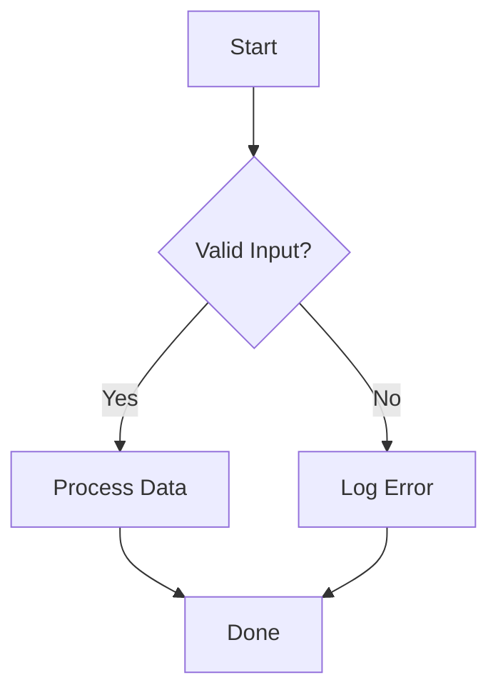
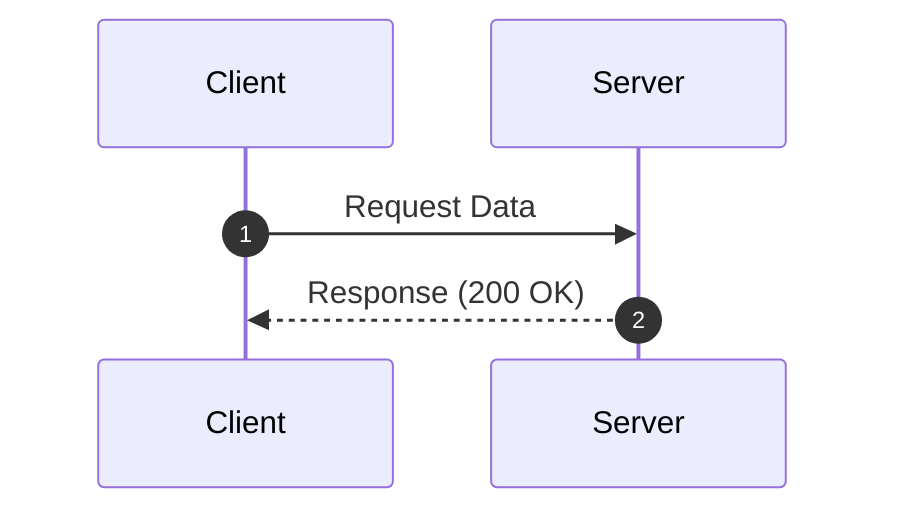

This page provides full validation coverage across every rendering subsystem of the `hugodex-k` blog engine.

---

## 1. Advanced Mathematics (LaTeX / KaTeX) Full Verification

### 1.1 Inlines and Greek Letters
- Equation: $x_1 + x_2 + x_3 = \sum_{i=1}^3 x_i$
- Inner product: $\inner{u}{v} = \sum_{k=1}^n u_k v_k$
- Norm: $\norm{v} = \sqrt{\inner{v}{v}}$
- Function spaces: $f \in L^2(\R) \cap L^1(\R)$, complex field $\C$, integers $\Z$
- Greek characters: $\alpha, \beta, \gamma, \delta, \epsilon, \zeta, \eta, \theta, \lambda, \mu, \pi, \sigma, \phi, \psi, \omega$ and uppercase $\Gamma, \Delta, \Theta, \Lambda, \Sigma, \Phi, \Omega$

### 1.2 Maxwell's Equations

$$
\begin{aligned}
\nabla \cdot \mathbf{E} &= \frac{\rho}{\varepsilon_0} \\
\nabla \cdot \mathbf{B} &= 0 \\
\nabla \times \mathbf{E} &= -\frac{\partial \mathbf{B}}{\partial t} \\
\nabla \times \mathbf{B} &= \mu_0 \left( \mathbf{J} + \varepsilon_0 \frac{\partial \mathbf{E}}{\partial t} \right)
\end{aligned}
$$

### 1.3 Matrix Types

$$
P = \begin{pmatrix} a & b \\ c & d \end{pmatrix}, \quad
B = \begin{bmatrix} 1 & 0 \\ 0 & 1 \end{bmatrix}, \quad
\det(V) = \begin{vmatrix} \lambda_1 & 0 \\ 0 & \lambda_2 \end{vmatrix}
$$

---

## 2. Mermaid Diagrams Verification

### 2.1 Flowchart

### 2.2 Sequence Diagram

---

## 3. Academic Callouts


For any real number $\theta$, $e^{i\theta} = \cos\theta + i\sin\theta$. When $\theta = \pi$:
$$
e^{i\pi} + 1 = 0
$$



An inner product space that is complete with respect to the distance metric induced by the inner product.


All tests confirm 100% offline self-hosted rendering without external CDN dependencies.

