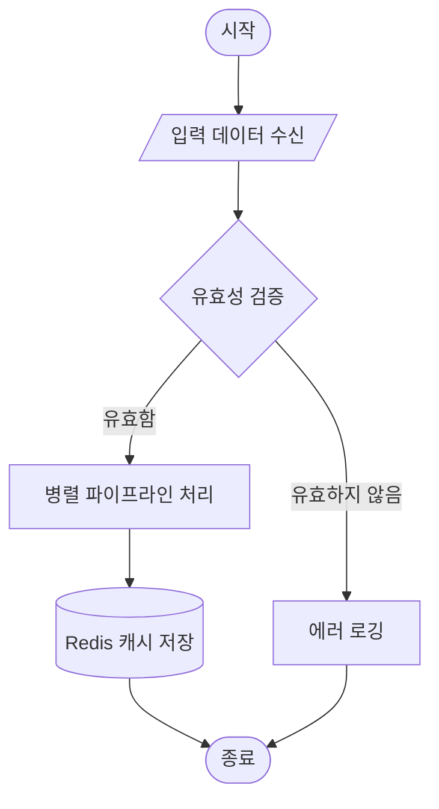
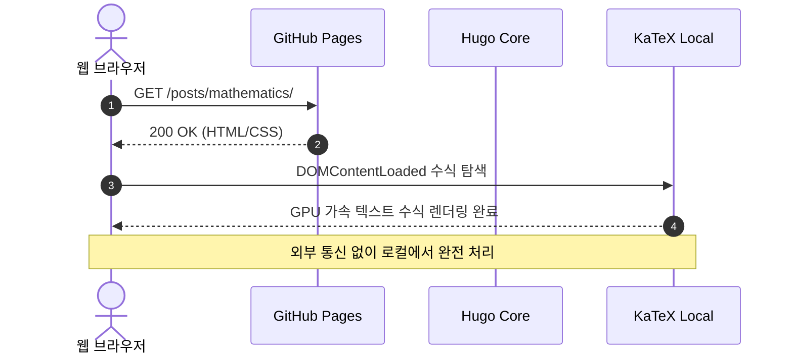
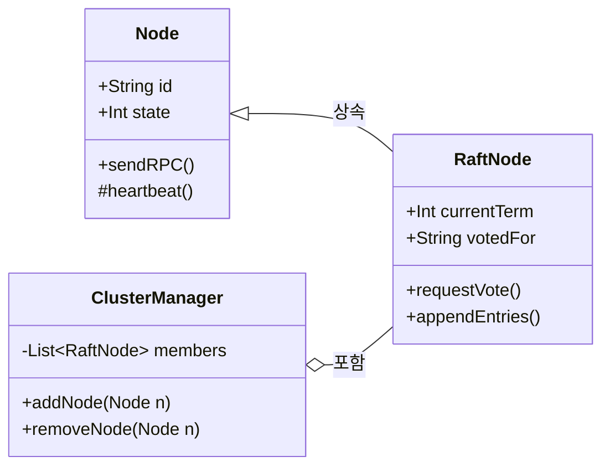
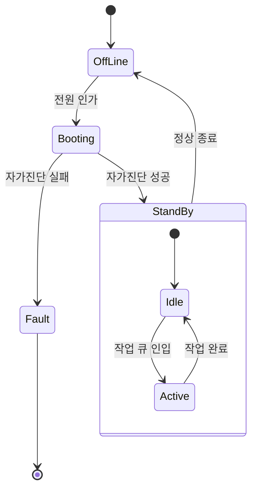
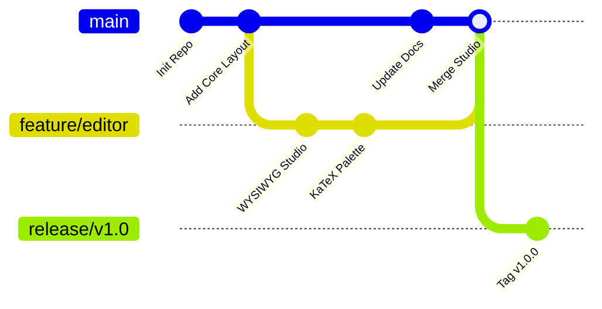
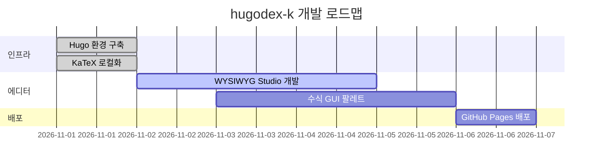
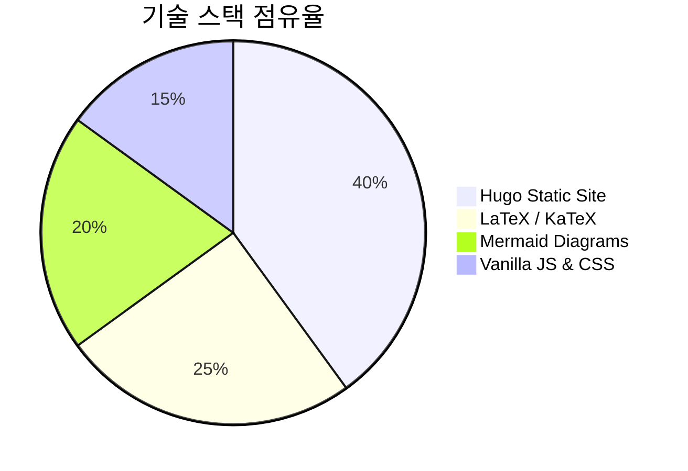
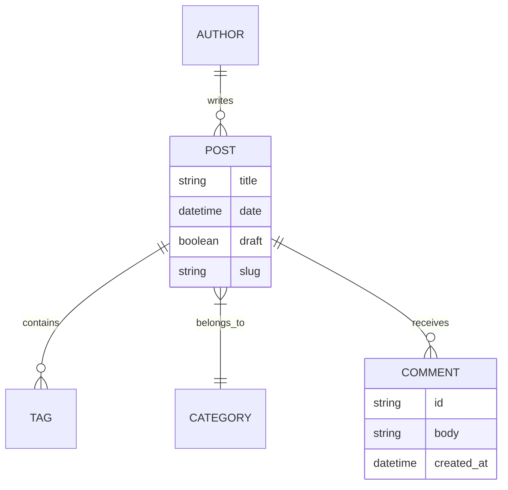
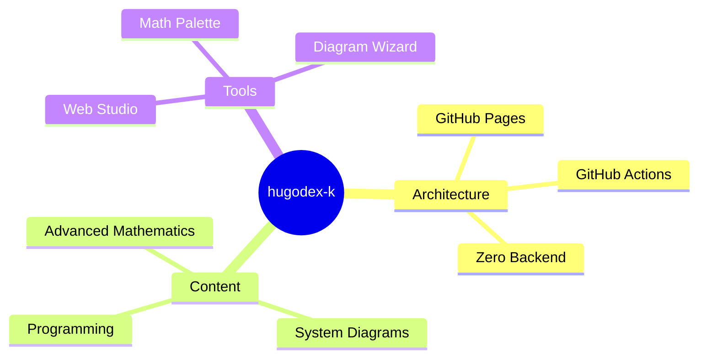

이 문서는 `hugodex-k` 블로그 엔진의 모든 렌더링 파이프라인이 정상적으로 동작하는지 검증하기 위한 종합 테스트 슈트(Full Test Suite)입니다.

---

## 1. 고급 수학 (LaTeX / KaTeX) 전체 스펙트럼 검증

### 1.1 인라인 수식 및 그리스 문자
인라인 수식 내에 언더스코어와 별표가 포함되어도 마크다운 이탤릭/볼드 간섭 없이 정상 렌더링됩니다:
- 수식: $x_1 + x_2 + x_3 = \sum_{i=1}^3 x_i$
- 상대성 이론: $E = \sqrt{(m_0 c^2)^2 + (pc)^2}$
- 내적 매크로: $\inner{u}{v} = \sum_{k=1}^n u_k v_k$
- 노름 매크로: $\norm{v} = \sqrt{\inner{v}{v}}$
- 공간 표기: $f \in L^2(\R) \cap L^1(\R)$, 복소 평면 $\C$, 자연수 $\N$, 정수 $\Z$, 유리수 $\Q$
- 그리스 문자 전수: $\alpha, \beta, \gamma, \delta, \epsilon, \zeta, \eta, \theta, \iota, \kappa, \lambda, \mu, \nu, \xi, \pi, \rho, \sigma, \tau, \upsilon, \phi, \chi, \psi, \omega$ 및 대문자 $\Gamma, \Delta, \Theta, \Lambda, \Xi, \Pi, \Sigma, \Upsilon, \Phi, \Psi, \Omega$

### 1.2 블록 수식 및 다중 적분/미분방정식
맥스웰 방정식(Maxwell's Equations in Differential Form):

$$
\begin{aligned}
\nabla \cdot \mathbf{E} &= \frac{\rho}{\varepsilon_0} \\
\nabla \cdot \mathbf{B} &= 0 \\
\nabla \times \mathbf{E} &= -\frac{\partial \mathbf{B}}{\partial t} \\
\nabla \times \mathbf{B} &= \mu_0 \left( \mathbf{J} + \varepsilon_0 \frac{\partial \mathbf{E}}{\partial t} \right)
\end{aligned}
$$

### 1.3 행렬의 모든 유형
네 가지 주요 행렬 괄호 환경 및 텐서 표기:

$$
P = \begin{pmatrix} a & b \\ c & d \end{pmatrix}, \quad
B = \begin{bmatrix} 1 & 0 & 0 \\ 0 & 1 & 0 \\ 0 & 0 & 1 \end{bmatrix}, \quad
\det(V) = \begin{vmatrix} \lambda_1 & 0 \\ 0 & \lambda_2 \end{vmatrix}, \quad
N = \begin{Vmatrix} x_{11} & x_{12} \\ x_{21} & x_{22} \end{Vmatrix}
$$

리만 곡률 텐서(Riemann Curvature Tensor):

$$
R^\rho_{\ \sigma\mu\nu} = \partial_\mu \Gamma^\rho_{\nu\sigma} - \partial_\nu \Gamma^\rho_{\mu\sigma} + \Gamma^\rho_{\mu\lambda}\Gamma^\lambda_{\nu\sigma} - \Gamma^\rho_{\nu\lambda}\Gamma^\lambda_{\mu\sigma}
$$

### 1.4 연립방정식 (Cases 환경)

$$
f(x) = \begin{cases}
0, & \text{if } x < 0 \\
\dfrac{1}{2}, & \text{if } x = 0 \\
1 - e^{-\lambda x}, & \text{if } x > 0
\end{cases}
$$

### 1.5 가환 다이어그램 (Commutative Diagram via CD)

$$
\begin{CD}
A @>f>> B \\
@V{g}VV @VV{h}V \\
C @>>k> D
\end{CD}
$$

### 1.6 특수 수학 서체 (19종 로컬 WOFF2 폰트 검증)
- 칠판 볼드체 (Blackboard Bold): $\mathbb{R}, \mathbb{C}, \mathbb{Z}, \mathbb{Q}, \mathbb{H}, \mathbb{P}$
- 프락투어 (Fraktur): $\mathfrak{g}, \mathfrak{h}, \mathfrak{so}(3), \mathfrak{su}(2), \mathfrak{sl}(n, \mathbb{C})$
- 칼리그래픽 (Caligraphic): $\mathcal{H}, \mathcal{F}, \mathcal{L}, \mathcal{O}(n \log n)$
- 산세리프 (Sans-serif): $\mathsf{GL}(n, \mathbb{R}), \mathsf{Hom}(V, W)$
- 타자기체 (Typewriter): $\mathtt{O}(1), \mathtt{nullptr}$

### 1.7 코드블록형 수식 렌더 훅 검증
마크다운 코드블록 ` ```math ` 및 ` ```latex ` 렌더 훅 테스트:

```math
\int_{0}^{\infty} \frac{\sin x}{x} \, dx = \frac{\pi}{2}
```

```latex
\lim_{n \to \infty} \left( 1 + \frac{1}{n} \right)^n = e = \sum_{k=0}^{\infty} \frac{1}{k!}
```

---

## 2. Mermaid 다이어그램 10대 유형 전수 검증

### 2.1 플로우차트 (Flowchart - TD & 분기)



### 2.2 시퀀스 다이어그램 (Sequence Diagram)



### 2.3 클래스 다이어그램 (Class Diagram)



### 2.4 상태 전이도 (State Diagram v2)



### 2.5 Git 그래프 (GitGraph)



### 2.6 간트 차트 (Gantt Chart)



### 2.7 파이 차트 (Pie Chart)



### 2.8 개체-관계 다이어그램 (ER Diagram)



### 2.9 마인드맵 (Mindmap)



---

## 3. 학술 콜아웃 블록 (Callouts)


임의의 실수 $\theta$에 대하여 다음 오일러 공식이 성립한다.
$$
e^{i\theta} = \cos\theta + i\sin\theta
$$
특히 $\theta = \pi$일 때, 수학의 5대 주요 상수($e, i, \pi, 1, 0$)를 결합한 가장 아름다운 식이 유도된다:
$$
e^{i\pi} + 1 = 0
$$



내적이 정의되어 있으며, 그 내적으로 유도되는 노름(Norm)에 관하여 완비성(Completeness)을 만족하는 내적공간을 **힐베르트 공간**이라 한다.



코시 수열 $\{x_n\}$에 대하여 $\lim_{n, m \to \infty} \|x_n - x_m\| = 0$이라 하자. 공간이 바나흐 공간 성질을 만족하므로 극한값 $x = \lim_{n \to \infty} x_n$이 공간 내에 유일하게 존재한다. $\blacksquare$



이 블로그의 모든 수식과 다이어그램은 외부 CDN 요청 없이 브라우저 캐시에서 즉시 로드됩니다.



GitHub 토큰(PAT)을 웹 에디터에 등록할 때 `Contents: Read and write` 권한만 부여하고 다른 불필요한 관리자 권한은 해제하는 것을 권장합니다.


---

## 4. 다중 언어 탭 컴포넌트 (Multi-language Tabs)

동일한 알고리즘(퀵 소트)을 다양한 언어로 비교합니다.



```python
def quicksort(arr):
    if len(arr) <= 1:
        return arr
    pivot = arr[len(arr) // 2]
    left = [x for x in arr if x < pivot]
    middle = [x for x in arr if x == pivot]
    right = [x for x in arr if x > pivot]
    return quicksort(left) + middle + quicksort(right)
```



```go
package main

func quickSort(arr []int) []int {
    if len(arr) < 2 {
        return arr
    }
    pivot := arr[0]
    var left, right []int
    for _, v := range arr[1:] {
        if v <= pivot {
            left = append(left, v)
        } else {
            right = append(right, v)
        }
    }
    result := append(quickSort(left), pivot)
    return append(result, quickSort(right)...)
}
```



```rust
fn quicksort<T: Ord + Clone>(slice: &[T]) -> Vec<T> {
    if slice.len() <= 1 {
        return slice.to_vec();
    }
    let pivot = &slice[0];
    let mut left = Vec::new();
    let mut right = Vec::new();
    for item in &slice[1..] {
        if item <= pivot {
            left.push(item.clone());
        } else {
            right.push(item.clone());
        }
    }
    let mut result = quicksort(&left);
    result.push(pivot.clone());
    result.extend(quicksort(&right));
    result
}
```



---

## 5. 인라인 SVG 벡터 그래픽 검증

Hugo 단축코드 ``를 활용한 기하학적 벡터 도형:


<svg viewBox="0 0 400 120" xmlns="http://www.w3.org/2000/svg" style="max-width: 100%; height: auto; display: block; margin: 0 auto; background: var(--bg-card); border-radius: 8px; border: 1px solid var(--border-color);">
  <circle cx="60" cy="60" r="40" fill="#3b82f6" opacity="0.8" />
  <circle cx="100" cy="60" r="40" fill="#10b981" opacity="0.8" />
  <text x="80" y="65" fill="#fff" font-weight="bold" font-size="14" text-anchor="middle">A ∩ B</text>
  
  <rect x="200" y="25" width="160" height="70" rx="6" fill="#f59e0b" opacity="0.9" />
  <text x="280" y="65" fill="#fff" font-weight="bold" font-size="14" text-anchor="middle">Vector Box</text>
</svg>


---

## 6. 대화형 인터랙티브 JS 샌드박스 검증

마크다운 내부에 격리된 채 실행되는 실시간 마우스 인터랙티브 캔버스입니다:


<style>
  body { margin: 0; background: #0b0f19; overflow: hidden; display: flex; align-items: center; justify-content: center; }
  canvas { background: #0b0f19; }
</style>
<canvas id="pCanvas" width="400" height="220"></canvas>
<script>
  const canvas = document.getElementById('pCanvas');
  const ctx = canvas.getContext('2d');
  const particles = [];
  for (let i = 0; i < 30; i++) {
    particles.push({
      x: Math.random() * canvas.width,
      y: Math.random() * canvas.height,
      vx: (Math.random() - 0.5) * 1.5,
      vy: (Math.random() - 0.5) * 1.5,
      radius: Math.random() * 3 + 2,
      color: `hsl(${Math.random() * 360}, 80%, 60%)`
    });
  }

  function render() {
    ctx.clearRect(0, 0, canvas.width, canvas.height);
    for (let p of particles) {
      p.x += p.vx; p.y += p.vy;
      if (p.x < 0 || p.x > canvas.width) p.vx *= -1;
      if (p.y < 0 || p.y > canvas.height) p.vy *= -1;
      ctx.beginPath();
      ctx.arc(p.x, p.y, p.radius, 0, Math.PI * 2);
      ctx.fillStyle = p.color;
      ctx.fill();
    }
    requestAnimationFrame(render);
  }
  render();
</script>


---

## 7. 마크다운 표준 서식 및 테이블 검증

| 기능 | 지원 여부 | 렌더링 엔진 | 비고 |
| :--- | :---: | :--- | :--- |
| **LaTeX 인라인/블록** | ✅ 지원 | KaTeX v0.16.11 (로컬) | WOFF2 폰트 19종 내장 |
| **Mermaid 10종** | ✅ 지원 | Mermaid.js v10.9.1 (로컬) | 다크/라이트 테마 자동 동기화 |
| **Chroma 구문 강조** | ✅ 지원 | Hugo Chroma 정적 빌드 | 복사 버튼, 줄 번호 내장 |
| **다국어 (i18n)** | ✅ 지원 | Hugo Native i18n | 한국어 및 영문 완벽 페어링 |
| **인터랙티브 샌드박스**| ✅ 지원 | iframe `srcdoc` 격리 | Canvas / WebGL / JS 구동 |
| **무서버 웹 에디터** | ✅ 지원 | GitHub REST API SPA | PAT 기반 직접 커밋 |
| **댓글 (Giscus)** | ✅ 지원 | GitHub Discussions | 외부 DB 제로 |

- [x] LaTeX 수식 렌더링 완벽 검증
- [x] Mermaid 다이어그램 10개 유형 검증
- [x] 다중 언어 탭 컴포넌트 검증
- [x] 인터랙티브 샌드박스 검증
- [x] 원클릭 코드 복사 및 다크모드 전환 검증

이상으로 `hugodex-k`의 모든 렌더링 요소가 결함 없이 완벽히 지원됨을 확인했습니다.

