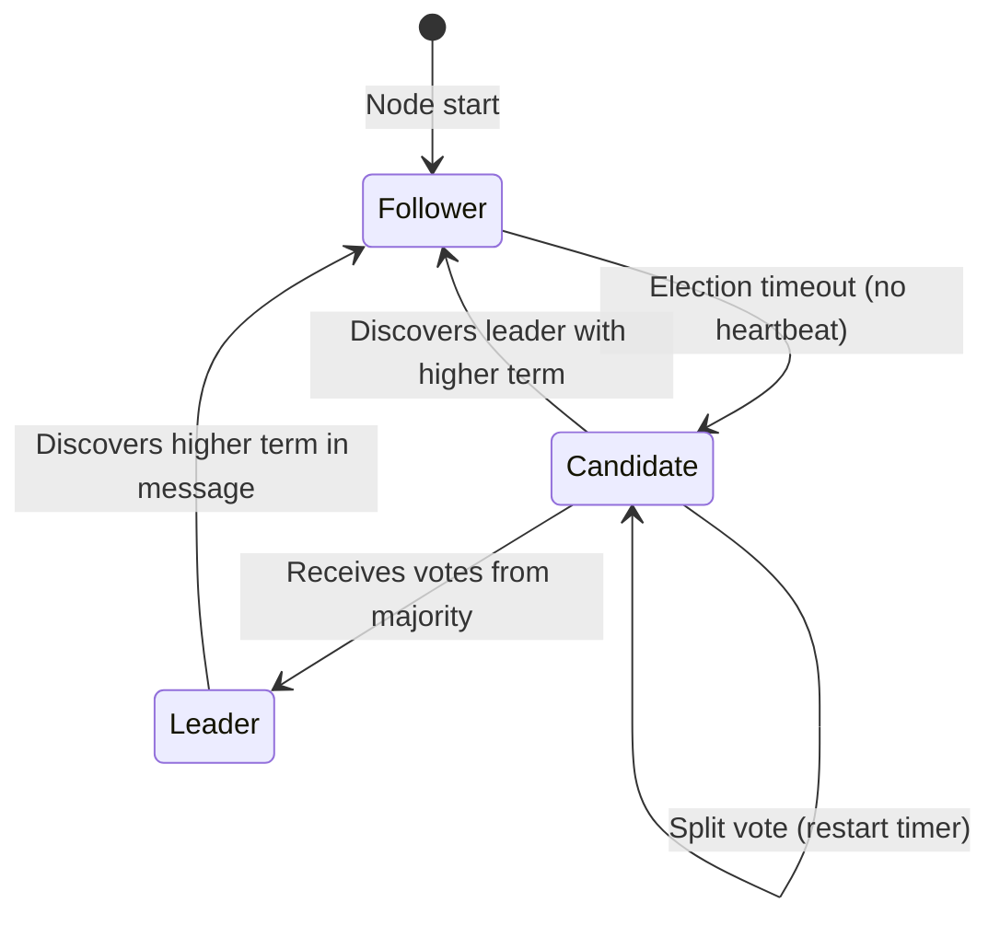
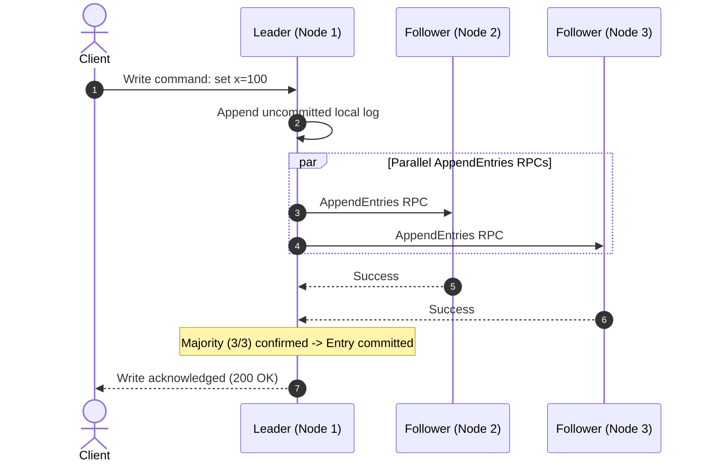

Maintaining a consistent replicated state across multiple machines despite network partitions, packet drops, and node failures is one of the foundational challenges in distributed systems.

---

## 1. Architecture Topology and Image

Below is an illustration of the distributed cluster topology and post attachment:

---

## 2. Node State Transition Model

Raft simplifies consensus by decomposing node roles into three distinct states:
1. **Leader**: Handles all client requests and manages log replication
2. **Follower**: Passively responds to heartbeats and log entries
3. **Candidate**: Initiates election votes when heartbeat timeouts occur

---

## 3. Quorum Formulation

For a cluster of $N$ nodes, the minimum quorum $Q$ required to guarantee progress despite $f$ failures is:

$$
Q = \left\lfloor \frac{N}{2} \right\rfloor + 1, \quad N \ge 2f + 1
$$


If a log entry is committed in a given term, that entry will be present in the logs of the leaders for all higher-numbered terms:
$$
\text{committed}(e, \tau) \implies \forall \tau' > \tau, \ e \in \text{log}(\text{leader}_{\tau'})
$$


---

## 4. Replication Pipeline

