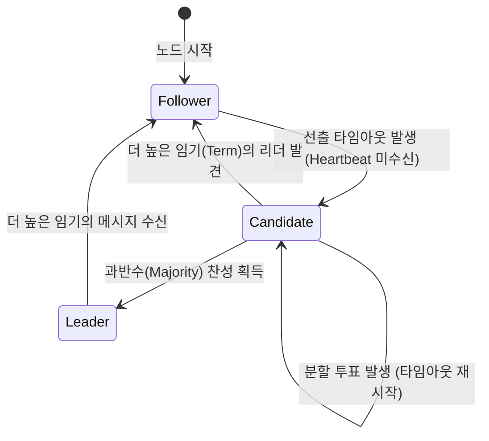
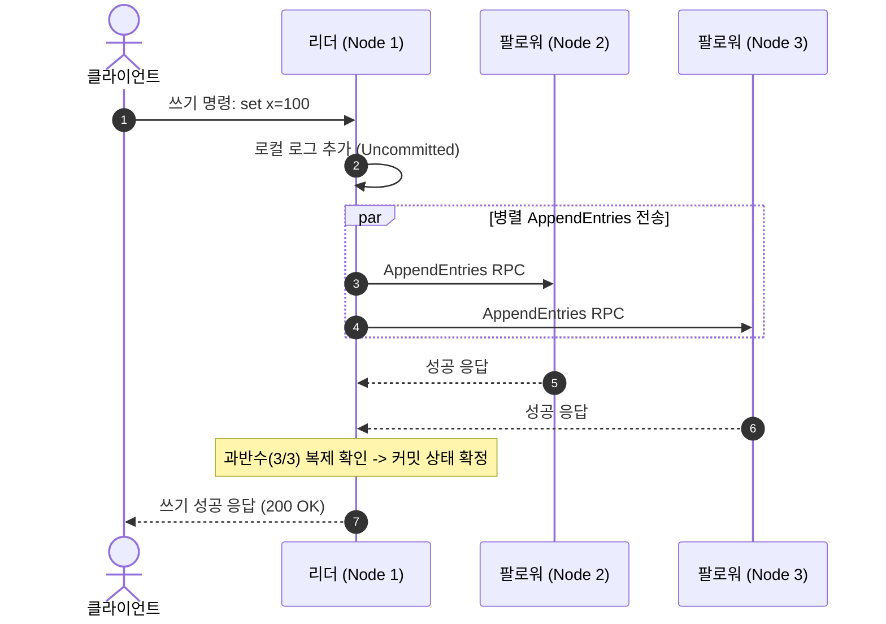

분산 시스템에서 여러 노드가 네트워크 지연, 패킷 유실, 노드 장애 상황 속에서도 일관된 상태(Consensus)를 유지하는 것은 가장 기초적이면서도 도전적인 문제입니다.

---

## 1. 아키텍처 다이어그램 및 이미지

아래는 분산 클러스터 노드 간 토폴로지를 나타내는 시각화 다이어그램 및 첨부 이미지입니다.

---

## 2. 노드 상태 전이 모델

Raft는 노드의 역할을 명확히 셋으로 구분하여 알고리즘을 단순화했습니다:
1. **리더 (Leader)**: 모든 클라이언트 요청을 수신하고 로그 복제를 전담
2. **팔로워 (Follower)**: 리더의 하트비트와 로그를 수동적으로 수신
3. **후보자 (Candidate)**: 하트비트 타임아웃 발생 시 새 리더 선출을 위해 투표 요청

---

## 3. 정족수(Quorum) 수식

클러스터의 총 노드 수가 $N$개일 때, $f$개의 노드가 고장 나더라도 정상적으로 합의에 도달하기 위한 최소 정족수 $Q$는 다음과 같이 정의됩니다:

$$
Q = \left\lfloor \frac{N}{2} \right\rfloor + 1, \quad N \ge 2f + 1
$$


어떤 임기(Term)에서 로그 항목이 커밋되었다면, 그보다 높은 번호의 임기를 가진 리더는 반드시 해당 로그 항목을 자신의 로그에 포함하고 있어야 합니다.
$$
\text{committed}(e, \tau) \implies \forall \tau' > \tau, \ e \in \text{log}(\text{leader}_{\tau'})
$$


---

## 4. 리더 선출 파이프라인

이와 같이 Raft는 Paxos에 비해 상태 머신 구조를 직관적으로 설계하여 엔지니어링 구현과 디버깅 난이도를 획기적으로 낮추었습니다.
