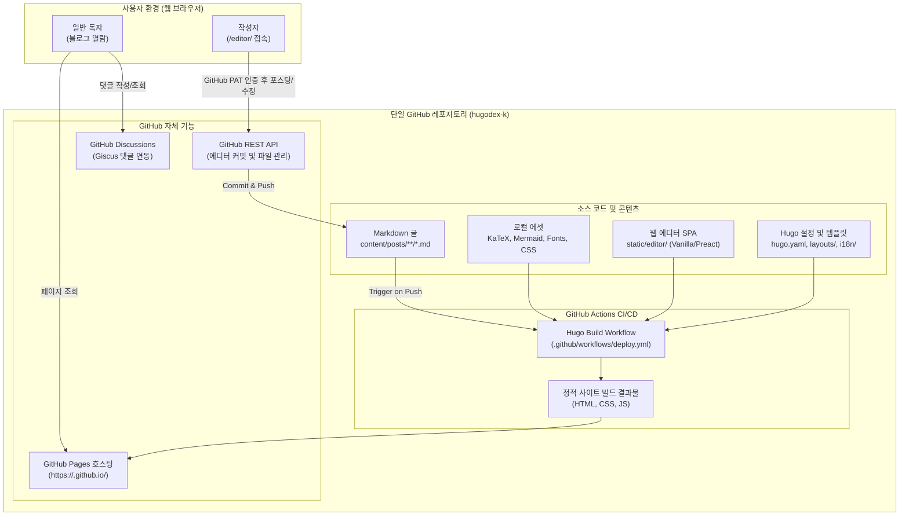

# hugodex-k 정적 블로그 구축 마스터 계획서 (Master Plan)

> **프로젝트명**: hugodex-k (Hugo Extended Knowledge Blog)  
> **목표**: 외부 서버/유료 서비스 없이 오직 단일 GitHub 레포지토리(GitHub Pages)만으로 구동되는, 프로그래밍·고급 수학·구조도 특화 다국어 정적 블로그 및 웹 기반 WYSIWYG 포스팅 시스템 구축.

---

## 1. 프로젝트 요구사항 및 목표 아키텍처

### 1.1 기본 구조 원칙
1. **완전한 무서버·단일 레포지토리 (Serverless & Single Repo)**
   - 별도 외부 호스팅, DB, BaaS(Firebase, Supabase 등) 사용 금지.
   - 단일 GitHub 저장소(`hugodex-k`)에서 모든 코드, 글(Markdown), 정적 에셋, 빌드 스크립트, 웹 에디터를 관리.
   - GitHub Pages + GitHub Actions를 통한 정적 사이트 자동 빌드 및 배포.
2. **독립성 및 외부 의존성 최소화 (Self-hosted Assets)**
   - CDN(cdnjs, unpkg, jsdelivr 등) 의존성을 배제하고, 필요한 모든 렌더링 엔진(KaTeX, Mermaid.js 등), 폰트, CSS/JS를 레포지토리 내부에 직접 번들링하여 호스팅.
   - 오프라인 환경에서도 빌드/렌더링이 보장되는 견고한 구조.
3. **특화 콘텐츠 렌더링**
   - **프로그래밍**: Hugo 내장 Chroma 기반 고성능 정적 코드 하이라이팅, 줄 번호, 파일명 표시, 원클릭 복사 버튼.
   - **고급 수학**: KaTeX 로컬 번들링 기반 고속 인라인/블록 수식(`$..$`, `$$..$$`), `amsmath` 환경, 수식 번호(equation numbering) 지원.
   - **다이어그램**: Mermaid.js 로컬 번들링 기반 플로우차트, 시퀀스 다이어그램, 클래스 다이어그램, 상태도, Git 그래프 렌더링.
   - **SVG & 미디어**: 인라인 SVG 렌더링 단축코드, 인터랙티브 SVG, 로컬 이미지 최적화, 반응형 비디오 임베딩.
   - **인터랙티브 웹 컴포넌트**: 마크다운 내부에서 JS/HTML을 활용한 대화형 그래프/시뮬레이션 삽입 지원.

### 1.2 웹 기반 WYSIWYG 에디터 및 포스팅 시스템
1. **웹 브라우저 기반 무설치 에디터 (In-browser Editor SPA)**
   - 블로그 경로 내(`/editor/` 또는 `/admin/`)에 정적 웹 에디터 내장. 별도 데스크톱 앱이나 플러그인 불필요.
   - 브라우저 로컬스토리지에 GitHub Personal Access Token(Fine-grained PAT)을 안전하게 저장하여 GitHub REST API와 직접 통신.
   - 글 목록 조회, 기존 글 수정, 신규 글 생성, 임시저장(Draft: true/false), 삭제 및 GitHub 직접 커밋.
2. **WYSIWYG 중심의 특화 편집 도구**
   - **수식(LaTeX) GUI 팔레트**: 분수, 거듭제곱, 적분, 시그마, 행렬, 그리스 문자, 수학 기호 등을 클릭하여 수식을 구성하고 실시간 렌더링 프리뷰를 보며 본문에 삽입.
   - **Mermaid 다이어그램 위자드**: 다이어그램 종류 선택 템플릿, 노드 및 관계선 추가 폼을 통한 시각적 작성.
   - **SVG 도형/드로잉 도구**: 기본 도형 및 벡터 구조를 시각적으로 추가하거나 SVG 코드를 즉시 미리보기하며 삽입.
   - **미디어 업로더**: 이미지 드래그 앤 드롭 시 GitHub API로 `static/images/`에 커밋하고 마크다운 경로 자동 삽입.
3. **폴더 구조, 태그, 카테고리 관리**
   - 마크다운 Front Matter(YAML)를 폼 기반으로 직관적으로 입력 (카테고리 폴더, 태그, 다국어 설정, 작성일, 슬러그 등).
4. **댓글 시스템**
   - **Giscus** 채택: GitHub Discussions API를 활용하므로 외부 DB나 유료 서버 없이 단일 레포의 토론 기능으로 댓글 완벽 구동.

### 1.3 다국어(i18n) 및 SEO 체계
1. **다국어 파일 구조**
   - 기본 언어: 한국어 (`ko`), 보조 언어: 영어 (`en`).
   - Hugo 네이티브 i18n 시스템 활용: `index.ko.md` 및 `index.en.md` (Page Bundle 구조).
   - 언어 전환 토글(Language Switcher) 제공 및 상호 매핑. 영문 번역본이 없는 경우 친절한 안내 제공.
2. **SEO 최적화**
   - 언어별 `hreflang` 태그, Canonical URL, OpenGraph 메타태그, Twitter Card 자동 생성.
   - 다국어 통합/분리 Sitemap(`sitemap.xml`) 및 RSS Feed(`index.xml`).
   - 학술/기술 블로그에 적합한 JSON-LD(Schema.org: `TechArticle`, `BlogPosting`) 구조화 데이터 삽입.

---

## 2. 시스템 아키텍처 상세 설계



---

## 3. 디렉터리 구조 설계 (Directory Structure)

```text
hugodex-k/
├── .github/
│   └── workflows/
│       └── deploy.yml            # GitHub Actions 빌드 및 Pages 배포 파이프라인
├── assets/
│   ├── css/
│   │   ├── main.css              # 전역 스타일 및 반응형 레이아웃
│   │   ├── chroma.css            # Chroma 문법 하이라이팅 테마 (다크/라이트)
│   │   └── katex.min.css         # 로컬 번들링된 KaTeX CSS
│   ├── js/
│   │   ├── katex.min.js          # 로컬 KaTeX 엔진
│   │   ├── auto-render.min.js    # 수식 자동 렌더링 모듈
│   │   ├── mermaid.min.js        # 로컬 Mermaid.js 다이어그램 엔진
│   │   └── blog.js               # 테마 토글, 코드 복사, 언어 스위처 등
│   └── fonts/                    # KaTeX 수식 폰트 및 웹폰트 (woff2)
├── content/
│   └── posts/                    # 블로그 포스트 디렉터리 (카테고리별 폴더 분리)
│       └── math-and-code/
│           ├── index.ko.md       # 한국어 원문
│           ├── index.en.md       # 영문 번역본
│           └── interactive.js    # 포스트 전용 인터랙티브 JS (Page Bundle)
├── layouts/                      # Hugo HTML 템플릿
│   ├── _default/
│   │   ├── baseof.html           # 기본 HTML 골격 (SEO, 메타태그, 폰트 로드)
│   │   ├── list.html             # 목록/카테고리/태그 페이지
│   │   └── single.html           # 본문 페이지 (Giscus 댓글, 라이선스, 언어선택)
│   ├── partials/
│   │   ├── head.html             # 메타, KaTeX/Mermaid 에셋 로더
│   │   ├── header.html           # 네비게이션, 검색, 다크모드, 언어 스위처
│   │   ├── footer.html           # 카피라이트, 사이트맵 링크
│   │   └── comments.html         # Giscus 댓글 연동 템플릿
│   └── shortcodes/               # 확장 마크다운 단축코드
│       ├── katex.html            # 수식 블록 단축코드 (옵션)
│       ├── mermaid.html          # 머메이드 다이어그램 컨테이너
│       ├── svg.html              # 인라인 SVG 렌더러
│       ├── interactive.html      # JS/HTML 인터랙티브 샌드박스
│       └── callout.html          # 알림/주의/팁 콜아웃 박스
├── i18n/
│   ├── ko.yaml                   # 한국어 UI 번역 스트링
│   └── en.yaml                   # 영어 UI 번역 스트링
├── static/
│   ├── editor/                   # 웹 WYSIWYG 에디터 SPA (빌드된 단일 HTML/JS)
│   │   ├── index.html            # 에디터 UI 메인
│   │   ├── editor.js             # GitHub API 연동, WYSIWYG, 수식/다이어그램 위자드
│   │   └── editor.css            # 에디터 전용 스타일시트
│   ├── images/                   # 범용 이미지 리소스
│   └── favicon.ico
├── temp/                         # 개발 계획, 진행상황, 기술 노트 (Git 관리 또는 개발용)
│   ├── PLAN.md                   # 전체 마스터 계획 (본 문서)
│   ├── PROGRESS.md               # 단계별 진행 기록
│   └── NOTES.md                  # 주의사항, 기술 레퍼런스, 알아둘 점
├── hugo.yaml                     # Hugo 통합 설정 파일 (다국어, Chroma, 마크다운 옵션)
└── README.md
```

---

## 4. 확장 마크다운(Extended Markdown) 상세 사양

### 4.1 수식 (LaTeX / KaTeX)
- **인라인 수식**: `$E = mc^2$` 또는 `\\( f(x) = \int_{-\infty}^\infty e^{-t^2} dt \\)`
- **블록 수식**: 
  ```latex
  $$
  \nabla \times \mathbf{E} = -\frac{\partial \mathbf{B}}{\partial t}
  $$
  ```
- **수식 번호 매기기 (Auto-numbering)**:
  `\begin{equation} ... \end{equation}` 환경 자동 지원.

### 4.2 다이어그램 (Mermaid)
- **표준 코드 블록 지원**:
  ````markdown
  ```mermaid
  sequenceDiagram
      autonumber
      Alice->>Bob: Hello Bob, how are you?
      Bob-->>Alice: I am good thanks!
  ```
  ````
  Hugo의 Render Hook(`layouts/_default/_markup/render-codeblock-mermaid.html`)을 통해 자동으로 `<div class="mermaid">` 컨테이너로 변환되어 클라이언트 Mermaid.js에 의해 렌더링.

### 4.3 인라인 및 인터랙티브 SVG
- **단축코드**:
  ```markdown
  
  ```
  또는 직접 인라인 코드 삽입 단축코드:
  ```markdown
  
  <svg viewBox="0 0 100 100"> ... </svg>
  
  ```

### 4.4 대화형 JS/HTML 샌드박스 (Interactive Component)
- 특정 알고리즘 시각화, 수학적 함수 그래프(예: Canvas, WebGL, D3.js 기반 인터랙션):
  ```markdown
  
  <div id="fourier-canvas-container"></div>
  
  ```

---

## 5. 웹 기반 WYSIWYG 에디터 상세 설계

### 5.1 아키텍처 및 무서버 인증
- 브라우저 클라이언트 사이드 단독 실행 SPA (`/editor/`).
- 사용자가 GitHub 토큰(Fine-grained PAT)을 브라우저에 등록:
  - 권한 범위: Repository `Contents` (Read & Write), `Metadata` (Read).
  - 로컬 스토리지에 암호화/저장.
- 브라우저에서 Octokit/REST API를 사용하여 GitHub API를 직접 호출.
  - 파일 조회: `GET /repos/{owner}/{repo}/contents/content/posts/...`
  - 파일 커밋: `PUT /repos/{owner}/{repo}/contents/content/posts/...` (Base64 인코딩)

### 5.2 WYSIWYG 편집 인터페이스
1. **듀얼 뷰 / 비주얼 에디터**:
   - 리치 텍스트 툴바: 제목, 볼드, 이탤릭, 링크, 코드, 표, 리스트.
   - 마크다운을 직접 보지 않고도 작성 가능하며, 필요시 마크다운 원문 모드로 원클릭 전환.
2. **수학 수식 GUI 위자드 모달**:
   - 기호 팔레트: $\sum, \prod, \int, \frac{d}{dx}, \sqrt{x}, \partial, \infty, \pm, \approx, \neq, \le, \ge$
   - 템플릿: 분수 $\frac{A}{B}$, 위/아래 첨자 $A^{b}_{c}$, 행렬 $\begin{pmatrix} a & b \\ c & d \end{pmatrix}$, 연립방정식
   - 실시간 KaTeX 미리보기 창 제공.
3. **Mermaid 다이어그램 GUI 위자드 모달**:
   - 다이어그램 유형 선택: 플로우차트(TD/LR), 시퀀스 다이어그램, 클래스 다이어그램, 상태 다이어그램, 간트차트.
   - 기본 템플릿을 제공하고 노드/라벨/연결선 텍스트 폼을 통해 시각적으로 구성.
4. **SVG 및 미디어 삽입 위자드**:
   - 이미지 파일 드래그 앤 드롭: GitHub REST API로 `static/images/posts/...`에 자동 커밋 후 마크다운 삽입.
   - SVG 기본 도형 팔레트 및 미리보기.
5. **Front Matter 관리 폼**:
   - 제목, 슬러그(경로), 카테고리(폴더 선택), 태그(칩 형태 입력), 작성일자, 언어(한국어/영어), Draft 여부.

---

## 6. 단계별 실행 로드맵 (Actionable Roadmap)

| 단계 | 주요 작업 내용 | 산출물 |
| :--- | :--- | :--- |
| **Phase 1: 기획 및 아키텍처 수립** (현재) | • 요구사항 분석 및 마스터 계획서 수립<br>• `temp/` 내 계획, 진행상황, 주의사항 문서화 | `temp/PLAN.md`<br>`temp/PROGRESS.md`<br>`temp/NOTES.md` |
| **Phase 2: Hugo 프로젝트 스켈레톤 및 테마 기반 구축** | • `hugo.yaml` 구성 (다국어, 마크다운 렌더러, Chroma)<br>• 베이스 레이아웃(`baseof`, `single`, `list`, `head`, `header`, `footer`)<br>• 다크/라이트 테마 및 반응형 CSS 구축 | Hugo 테마 뼈대<br>Chroma 스타일<br>다국어 i18n 기본 파일 |
| **Phase 3: 특화 렌더러 로컬 번들링 및 단축코드 구현** | • KaTeX 엔진 및 폰트 파일 로컬 번들링<br>• Mermaid.js 로컬 번들링 및 자동 초기화 스크립트<br>• Codeblock Render Hooks(Mermaid, 수식)<br>• 인터랙티브 단축코드(`interactive`, `svg`, `callout`) 작성 | 로컬 에셋 번들<br>수식/다이어그램 렌더러<br>확장 마크다운 단축코드 |
| **Phase 4: 웹 WYSIWYG 에디터 SPA 구현** | • GitHub REST API 통신 모듈(PAT 기반 커밋/조회)<br>• 마크다운 WYSIWYG 에디터 UI 구현<br>• LaTeX 수식 GUI 팔레트 및 실시간 프리뷰<br>• Mermaid 다이어그램 위자드 모달<br>• 이미지 자동 업로드 및 Front Matter 폼 구현 | `static/editor/` SPA<br>(HTML/CSS/JS 완전 독립형) |
| **Phase 5: 다국어, 댓글(Giscus), SEO 및 CI/CD 배포 파이프라인** | • Giscus Discussions 댓글 연동 템플릿<br>• 언어별 hreflang, OpenGraph, sitemap, JSON-LD 구현<br>• GitHub Actions 배포 워크플로우(`.github/workflows/deploy.yml`) 작성 | 배포 파이프라인<br>댓글 및 다국어 완성 |
| **Phase 6: 종합 검증 및 샘플 포스트 작성** | • 프로그래밍, 고급 수학, 구조도, 인터랙티브 데모 글 작성(한/영)<br>• 빌드 테스트 및 최종 가이드 문서 작성 | 실증 샘플 포스트<br>최종 README 가이드 |

---

## 7. 기대 효과 및 검증 기준
1. **비용 0원 & 완전한 독립성**: GitHub Pages 외 일체의 외부 의존성/서버 없이 영구 무료 운영 가능.
2. **콘텐츠 표현력 극대화**: 대학원 수준의 수학 논문/공식, 복잡한 시스템 아키텍처 다이어그램, 실시간 대화형 시뮬레이션을 미려하게 표현.
3. **모바일/웹 어디서나 원스톱 포스팅**: PC나 태블릿 브라우저에서 `/editor/`로 접속하여 별도 Git CLI나 로컬 Hugo 설치 없이 마크다운 및 수식/다이어그램을 작성하고 즉시 배포.

